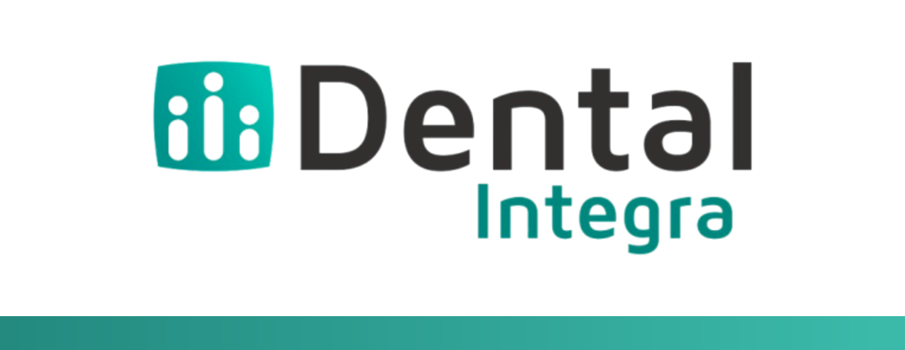
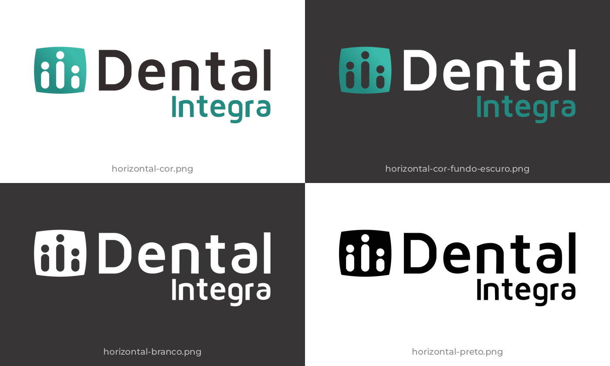
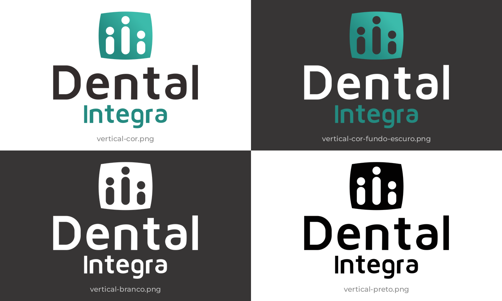
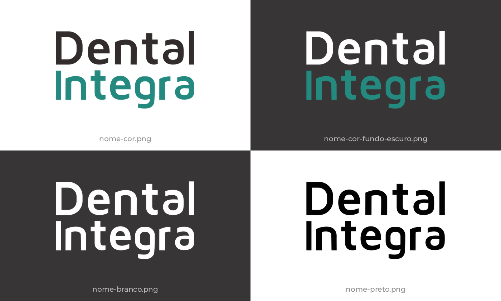
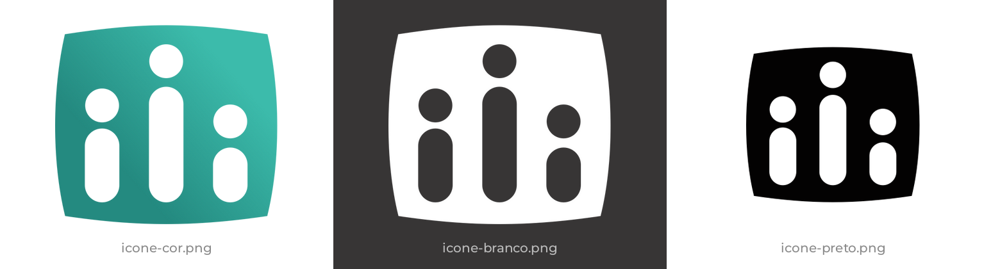
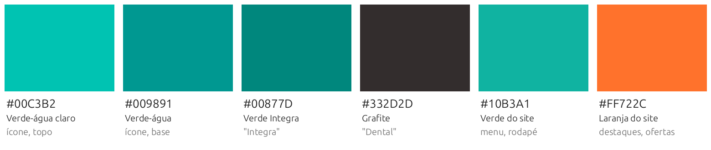
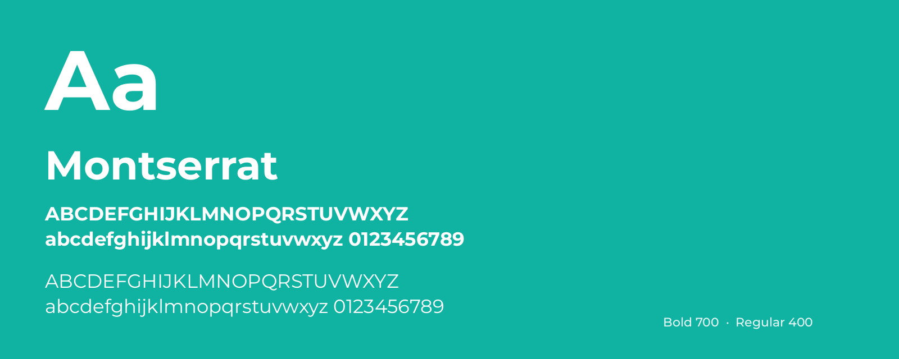
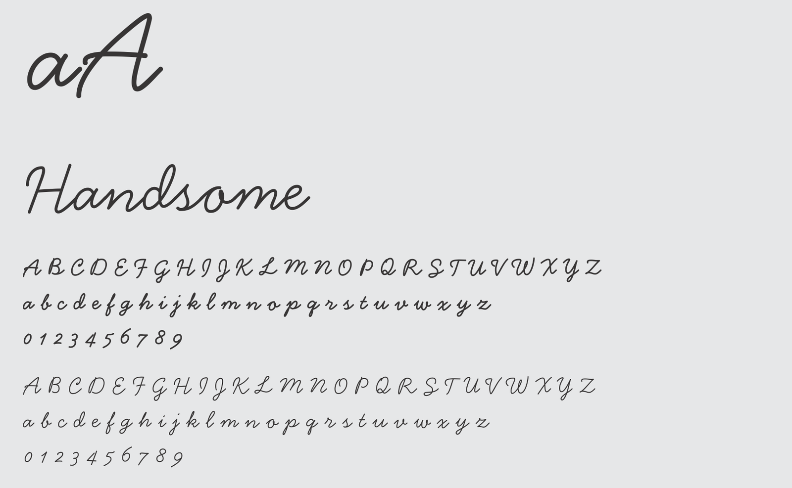
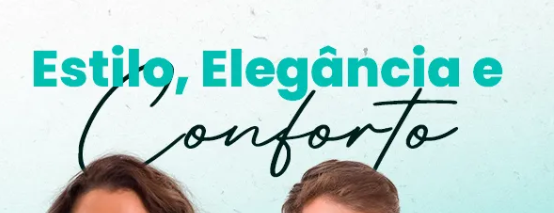
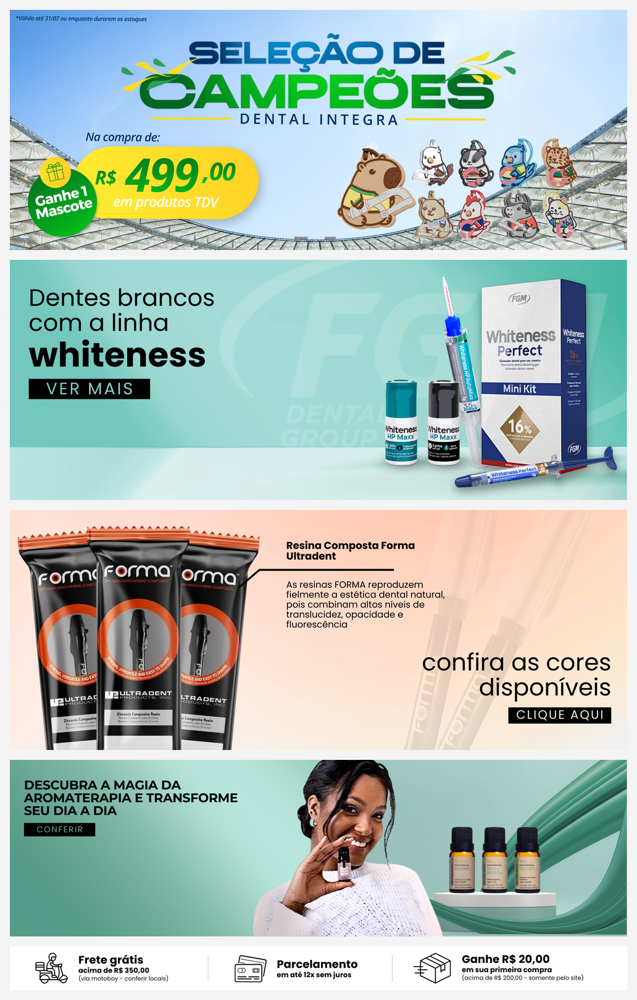

<p align="center">
  
</p>

# Dental Integra - media kit

Logos, cores, tipografia, estilo das peças, textos e contatos da **Dental Integra**, loja de produtos odontológicos em Rio das Ostras (RJ).

Fontes deste material:

- [`dental-integra-guia.pdf`](dental-integra-guia.pdf): guia da marca (Canva, 10/07/2025). É a referência oficial: onde o site diverge, vale o guia.
- [dentalintegra.com.br](https://www.dentalintegra.com.br) (loja Tray), lido em 05/11/2026: cores do tema, banners, textos, contatos e redes.

## Sumário

- [Qual arquivo usar](#qual-arquivo-usar)
- [Logo](#logo)
- [Cores](#cores)
- [Tipografia](#tipografia)
- [Estilo das peças](#estilo-das-peças)
- [Textos da marca](#textos-da-marca)
- [Contato e redes](#contato-e-redes)
- [Marcas vendidas](#marcas-vendidas)
- [Antes de imprimir](#antes-de-imprimir)
- [Estrutura do repositório](#estrutura-do-repositório)

## Qual arquivo usar

| Situação | Arquivo |
|---|---|
| Logo em tamanho grande, fundo claro | [`logo-dental-integra-transparente.png`](logo-dental-integra-transparente.png) (2234x782) |
| Logo em fundo claro | [`logos-guia/horizontal-cor.png`](logos-guia/horizontal-cor.png) |
| Logo em fundo escuro | [`logos-guia/horizontal-cor-fundo-escuro.png`](logos-guia/horizontal-cor-fundo-escuro.png) ou [`horizontal-branco.png`](logos-guia/horizontal-branco.png) |
| Espaço quadrado ou estreito | [`logos-guia/vertical-cor.png`](logos-guia/vertical-cor.png) |
| Foto de perfil, avatar, favicon | [`icone-dental-integra-transparente.png`](icone-dental-integra-transparente.png) (479x479) ou [`logos-guia/icone-cor.png`](logos-guia/icone-cor.png) |
| Impressão em uma cor, carimbo, fax | Versões `-preto` em [`logos-guia/`](logos-guia/) |
| Impressão grande (fachada, banner, adesivo) | Ainda não existe arquivo adequado: ver [Antes de imprimir](#antes-de-imprimir) |

## Logo

O símbolo é um quadrado de lados levemente curvos, em degradê verde-água, com três figuras (um ponto sobre uma barra arredondada), a do meio mais alta. O nome tem "Dental" grande e "Integra" menor, alinhado à direita embaixo.

O guia traz quatro arranjos. Cada um vem em quatro tratamentos; o símbolo sozinho, em três. Todos os arquivos de [`logos-guia/`](logos-guia/) são PNG com fundo transparente. No símbolo do guia, as figuras são vazadas: o fundo aparece através delas.

| Tratamento | Sufixo do arquivo | Usar sobre |
|---|---|---|
| Colorido, "Dental" em grafite | `-cor` | Fundo claro |
| Colorido, "Dental" em branco | `-cor-fundo-escuro` | Fundo escuro |
| Todo branco | `-branco` | Fundo escuro ou foto |
| Todo preto | `-preto` | Fundo claro, impressão em uma cor |

### Horizontal

Símbolo à esquerda. 543x176 pixels.



### Vertical

Símbolo em cima. 404x326 pixels.



### Só o nome

"Dental" e "Integra" em duas linhas, sem o símbolo. 387x217 pixels.



### Símbolo

347x311 pixels (o preto, 271x243).



### Versões de maior resolução

Os logos do guia são pequenos. As duas versões abaixo foram recortadas da imagem de compartilhamento do site ([`fonte-site/og-image.jpg`](fonte-site/og-image.jpg), 2500x836), a maior publicada. O fundo foi removido; no símbolo, as figuras ficaram preenchidas de branco.

| Arquivo | Tamanho |
|---|---|
| [`logo-dental-integra-transparente.png`](logo-dental-integra-transparente.png) | 2234x782 |
| [`icone-dental-integra-transparente.png`](icone-dental-integra-transparente.png) | 479x479 |

A fonte do nome não foi identificada; o guia não diz qual é.

## Cores



Paleta oficial, do guia:

| Cor | HEX | RGB | CMYK | Onde aparece |
|---|---|---|---|---|
| Verde-escuro | `#248A80` | 36, 138, 128 | 74, 0, 7, 46 | Palavra "Integra", começo do degradê do símbolo |
| Verde | `#10B3A1` | 16, 179, 161 | 91, 0, 10, 30 | Menu e rodapé do site, fundos de destaque no guia |
| Grafite | `#373535` | 55, 53, 53 | 0, 4, 4, 78 | Palavra "Dental", fundos escuros |
| Cinza-claro | `#E6E7E8` | 230, 231, 232 | 1, 0, 0, 9 | Fundos claros |
| Branco | `#FFFFFF` | 255, 255, 255 | 0, 0, 0, 0 | Pantone White 000C |

Degradê do símbolo: de `#248A80` (canto inferior esquerdo) a `#3CBBAB` (canto superior direito). O guia não lista o segundo valor; ele foi medido na imagem.

```css
:root {
  --di-verde-escuro: #248a80;
  --di-verde-claro: #3cbbab;
  --di-verde: #10b3a1;
  --di-grafite: #373535;
  --di-cinza-claro: #e6e7e8;
  --di-branco: #ffffff;
  --di-laranja-site: #ff722c;
  --di-degrade: linear-gradient(45deg, #248a80, #3cbbab);
}
```

### Cores do site, fora do guia

Variáveis do tema da loja Tray:

| Cor | HEX | Onde aparece |
|---|---|---|
| Laranja | `#FF722C` | Cor principal do tema, barra de ofertas, newsletter, preço anterior, etiqueta de desconto, botão comprar na página do produto |
| Verde | `#10B3A1` | Menu, rodapé, botão comprar na listagem, contador de promoção |
| Texto | `#333333`, `#555555`, `#111111` | Texto escuro, médio e títulos |
| Fundos | `#F6F6F6`, `#F0F0F0` | Depoimentos, divisórias |

O laranja não está no guia nem no logo: o site o usa para ofertas e chamadas.

## Tipografia

O guia lista duas famílias, sem dizer onde usar cada uma.

### Montserrat

Regular e bold. Gratuita: [Google Fonts](https://fonts.google.com/specimen/Montserrat).



### Handsome Pro

Regular e bold, manuscrita. É uma fonte comercial: o Canva a oferece, mas fora dele precisa de licença. Amostra tirada do guia:



No exemplo do guia, ela aparece numa palavra de destaque ("Conforto"), em contraste com o título em sans:



### No site

Roboto (300, 400, 500 e itálicos) é a fonte do tema; Source Sans Pro (400, 600, 700) também é carregada. Os títulos dos banners parecem Montserrat (são imagens, então não dá para confirmar).

## Estilo das peças

Banners em uso no site em 05/11/2026:

- Fundos em degradê verde-água claro (equipamentos, instrumentos, estética, kit acadêmico, WhatsApp) ou pêssego e salmão (jalecos, clareamento, resinas).
- Botões retangulares pretos com texto branco em caixa alta e letras espaçadas: "CONFERIR", "VER MAIS", "CLIQUE AQUI".
- Texto à esquerda, produto ou foto à direita.

### Banners principais, faixa e tarja



### Banners menores


### Vitrines


Os arquivos originais estão em [`fonte-site/`](fonte-site/). O banner `TDV.png` tem 14 MB (5625x2188).

## Textos da marca

- **Frase:** "Você merece. Você Pode!"
- **Descrição:** "Loja de produtos odontológicos. Encontre uma ampla variedade de produtos odontológicos de alta qualidade, incluindo instrumentos, equipamentos, materiais de consumo e muito mais. Atendemos a profissionais da área odontológica e estudantes."
- **Benefícios (tarja do site):** frete grátis acima de R$ 350,00 (via motoboy, conferir locais); parcelamento em até 12x sem juros; R$ 20,00 de desconto na primeira compra acima de R$ 200,00, só pelo site.

## Contato e redes

| Canal | Dado |
|---|---|
| Site | [dentalintegra.com.br](https://www.dentalintegra.com.br) |
| WhatsApp | [(22) 99734-1710](https://wa.me/5522997341710) |
| Telefone | (22) 2771-9474 |
| E-mail | dentalintegra@yahoo.com |
| Endereço | Rua Bangu, 881 - Rio das Ostras - RJ |
| Instagram | [@dental_integra](https://www.instagram.com/dental_integra/) |
| Facebook | [IntegraDentalRj](https://www.facebook.com/IntegraDentalRj) |
| TikTok Shop | [vt.tiktok.com/ZSxd8PwrR](https://vt.tiktok.com/ZSxd8PwrR/) |

## Marcas vendidas

Seção "Nossas Marcas" do site: Maquira, Dentsply, FGM, Orthometric, DFL, Ivoclar, 3M, Vigodent, American Burrs, Ultradent, Angelus, Rennova, TDV, Dentflex, Microdont.

## Antes de imprimir

- **Logo em vetor:** este kit não tem o logo em SVG, AI ou PDF vetorial. Os logos do guia têm de 271 a 543 pixels de largura e servem para tela e redes sociais em tamanho pequeno. Para impressão grande, peça o arquivo vetorial.
- **Cores:** os valores CMYK do guia são a conversão direta do RGB, sem perfil de cor de gráfica, e não há Pantone além do branco. Peça prova de cor à gráfica.

## Estrutura do repositório

```
.
├── README.md                              este guia
├── dental-integra-guia.pdf                guia da marca (oficial)
├── logo-dental-integra-transparente.png   logo horizontal, 2234x782
├── icone-dental-integra-transparente.png  símbolo, 479x479
├── paleta.png                             amostras de cor
├── logos-guia/                            15 versões do logo tiradas do guia
├── fonte-site/                            logos, favicon e banners baixados do site
└── previews/                              imagens deste README
```
